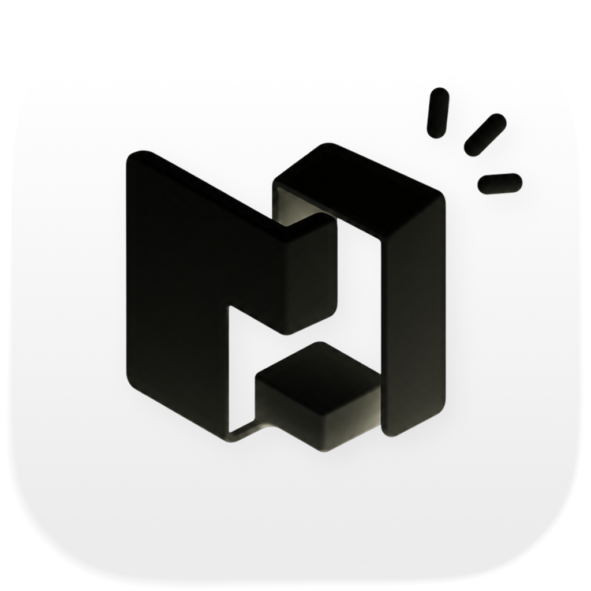
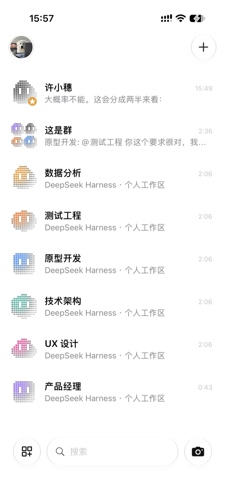
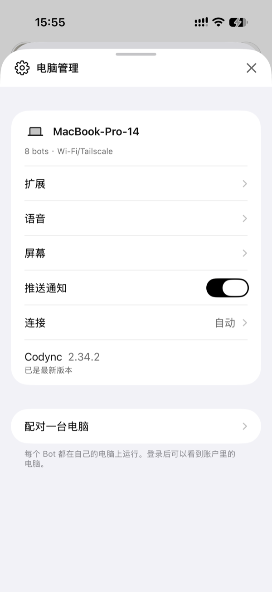
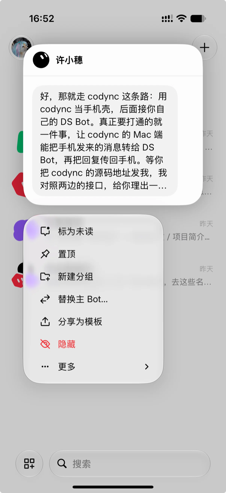
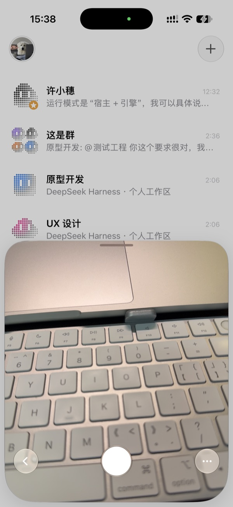

<div align="center">



# 半句 · Codync iOS 定制版

**把 Codync 的 iPhone 客户端，重做成更原生、更顺手的样子。**

基于 [Codync](https://github.com/leepokai/Codync) `v2.36.0` 的 iOS 界面定制分支 `ui/ios-customization`。


[](https://github.com/KouriVar/Codync/releases)
[](LICENSE)

</div>

> [!NOTE]
> 本仓库是 Codync 的**个人 fork**：保留已完成的 **iOS 界面与交互定制**，并在独立的 `ui/macos-customization` 分支增加 Mac 界面定制；不改 Host（Rust）与连接认证协议。Mac 本地安装以可用的官方 2.34.2 为底包，包含窗口按钮对齐与 Remix 图标，详见 [Mac 定制开发与安装](docs/guides/macos-ui-preview.md)。上游项目见 [leepokai/Codync](https://github.com/leepokai/Codync)。

Codync 的定位是把电脑上的编码智能体（Claude Code、Codex、Cursor、Gemini、OpenCode 等 40 多个）变成可以随时发消息的 **Bot**。这个 fork 保留全部能力，只解决一件事：**iPhone 上的观感与操作，做得更像原生 iOS。**

---

## 截图

| 聊天列表 | 电脑管理 |
| --- | --- |
|  |  |

| 长按预览（深色 · 8 行气泡） | 快速拍照 |
| --- | --- |
|  |  |

---

## iOS 改了什么

### 一、全原生化（C0050–C0061）

把项目里自绘的「页头 / 卡片 / 弹窗」整体换成系统组件：

| 原来（自绘） | 现在（原生） |
| --- | --- |
| `ModalHeader` 自绘 sheet 页头 | `NavigationStack` 系统导航栏（标题 + 原生关闭/保存） |
| `CardForm` / `CardSection` 卡片列表 | `Form` / `Section` 分组列表 |
| 列表行前置图标 | 去掉图标，右侧补 `chevron` |
| 自绘开关、下拉选择器 | 系统 `Toggle`、`Picker` / `Menu` |
| `codyncDialog` 自绘弹卡 | 系统 `.alert`（支持输入框与多按钮） |

覆盖页面包括：用量分析、产物重命名、网络、记忆说明/笔记、群设置、选文件夹、时区、访问授权、Trace、Handoff 编辑、附件查看、语音通话记录、主助理说明、Fallback、例行任务编辑、语音设置、Bot 编辑、电脑管理。

### 二、Grok 风格长按菜单（C0062–C0073）

- **原生 `contextMenu` + 自绘消息预览卡**：菜单保持系统的玻璃质感，预览卡自己做。
- **圆角统一 34pt**：关键是 `.contentShape(.contextMenuPreview, RoundedRectangle(cornerRadius: 34, style: .continuous))`——预览卡的可见圆角由它决定（等价于 UIKit 的 `UIPreviewParameters.visiblePath`），而不是 `clipShape`。
- **预览内容**：显示完整最后一条消息，最多 **8 行**，正文放在 22pt 圆角气泡里，卡片宽 320。
- **深色配色**：卡片底 `#141414`，气泡 `#232323`。
- **细节**：destructive 菜单项图标与文字同为红色；`More` 汉化为「更多」。

### 三、列表与排序

- 列表行去掉前置图标、补箭头，开关用系统组件。
- 拖动排序从聊天列表移除（它会吞掉长按手势），改为 **设置 → 列表排序**：按电脑分组、原生 `onMove` 拖动，松手即通过 `reorder` 同步到电脑。

### 四、品牌与其它

- App 显示名改为 **半句**，替换浅色/深色 App 图标。
- 首页底部玻璃工具条 + 快速拍照 sheet（拍完直接作为附件进入输入框）。
- 调试用环境变量（Debug 构建）：`CODYNC_ACCOUNT_PANE`、`CODYNC_SHOW_COMPUTERS`、`CODYNC_QUICKCAPTURE`、`CODYNC_OPEN_URL`。

---

## 构建与侧载（iOS）

> 本 fork 使用**免费个人签名**侧载到真机，因此 bundle id / App 名称都通过构建参数注入，避免影响工程默认值。

```bash
export DEVELOPER_DIR=/Applications/Xcode.app/Contents/Developer

# 新增文件后需要重新生成工程
xcodegen generate --spec apps/project.yml

xcodebuild build \
  -project apps/Codync.xcodeproj \
  -scheme 'iOS Dev' \
  -configuration DevDebug \
  -derivedDataPath build/dd \
  -destination 'platform=iOS,id=<设备 UDID>' \
  -allowProvisioningUpdates -allowProvisioningDeviceRegistration \
  DEVELOPMENT_TEAM=<你的 Team ID> \
  CURRENT_PROJECT_VERSION=93 \
  CODYNC_ENV=ui-preview \
  CODYNC_APP_NAME=半句 \
  CODYNC_IOS_BUNDLE_ID=com.example.codync.uipreview \
  CODYNC_APP_GROUP=group.com.example.codync.uipreview \
  CODYNC_KEYCHAIN_GROUP=com.example.codync.uipreview \
  CODYNC_URL_SCHEME=codync-ui-preview \
  CODE_SIGN_ENTITLEMENTS=ios/Resources/UIPreview.entitlements
```

安装与启动：

```bash
xcrun devicectl device install app --device <UDID> "build/dd/Build/Products/DevDebug-iphoneos/半句.app"
xcrun devicectl device process launch --device <UDID> com.example.codync.uipreview
```

### 常用构建参数

| 参数 | 作用 |
| --- | --- |
| `CODYNC_ENV=ui-preview` | 使用预览配置（不弹登录墙） |
| `CODYNC_APP_NAME` | App 显示名（本 fork 用 `半句`） |
| `CODYNC_IOS_BUNDLE_ID` | 注入 bundle id，复用已有描述文件 |
| `CODYNC_APP_GROUP` / `CODYNC_KEYCHAIN_GROUP` | App Group 与钥匙串组 |
| `CODYNC_URL_SCHEME` | 深链 scheme |
| `CODE_SIGN_ENTITLEMENTS` | 侧载用 entitlements（不含推送 / Apple 登录） |

---

## 目录结构（iOS 相关）

```
apps/
  project.yml                    # XcodeGen 工程描述
  ios/
    App/                         # App 入口、环境
    Views/                       # 根视图、设置、电脑管理、拍照、排序页等
    Kit/Sources/
      CodyncKit/                 # 模型、客户端、本地化（含 zh-Hans.json）
      CodyncUI/                  # 屏幕与状态：Bots / Thread / Call / Marketplace / ...
    Resources/Assets.xcassets/   # 半句 App 图标、默认头像
docs/
  images/                        # README 截图
  guides/change-recording.md     # 改动记录规则
CHANGELOG.md                     # C0001–C0073 全量改动记录
```

---

## 变更记录

- 全部改动逐条记录在 [`CHANGELOG.md`](CHANGELOG.md)（编号 `C0001`–`C0073`，含原因 / 变化 / 文件 / 验证 / 限制）。
- 版本说明见 Release：[`v2.36.0-ui.1`](https://github.com/KouriVar/Codync/releases/tag/v2.36.0-ui.1)。

---

## 上游与许可

- 上游项目：[leepokai/Codync](https://github.com/leepokai/Codync)（Apache 2.0）。
- 本 fork 的界面改动遵循同样许可；`codync-host`、桌面端、协议等均来自上游。
- 感谢上游作者与社区。
